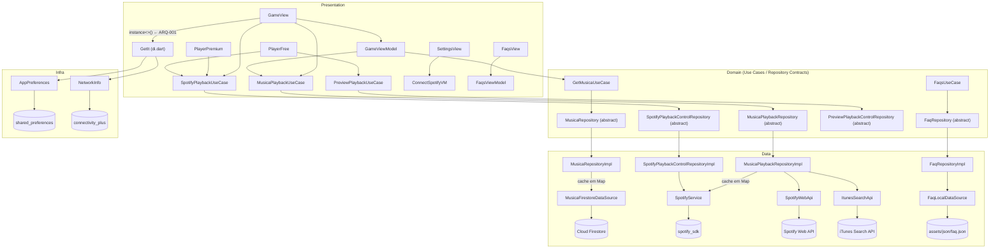

# Beatspan — Revisão Arquitetural Completa
**Projeto:** Beatspan
**Data da análise:** 2026-09-12
**Versão do documento:** 3.0
**Analista:** Arquiteto de Software Sênior / Principal Engineer (sessão automatizada)
**Análise anterior arquivada em:** `docs/archive/2026-09-12/1-ARCHITECTURAL_REVIEW.md`

> **Nota de acompanhamento (2026-09-12, pós-análise):** SEC-002 foi resolvido após esta análise — `.env` removido dos assets do `pubspec.yaml` e da dependência `flutter_dotenv`; credenciais Spotify agora injetadas via `--dart-define-from-file=env.json` e lidas com `String.fromEnvironment` em `lib/app/di.dart`; o Client ID Spotify anterior foi revogado e substituído por um novo no dashboard. As tabelas abaixo preservam o achado original como registro histórico da auditoria; status atualizado em `docs/SECURITY_REPORT.md` e `docs/TECH_DEBT_REGISTER.md`.

---

## Visão Geral do Projeto

Beatspan é um aplicativo Flutter Android-only (pré-lançamento) que acompanha um jogo de cartas de música no estilo Hitster. O fluxo central: câmera lê QR code da carta física → código é resolvido no Firestore → faixa é reproduzida via Spotify (Premium = faixa completa via App Remote SDK; Free = prévia 30 s via Spotify Web API com fallback iTunes Search API).

**Stack identificada:**

| Categoria | Tecnologia |
|-----------|------------|
| Framework | Flutter SDK `^3.9.2` (Dart `^3.9.2`) |
| Backend / Catálogo | Firebase Firestore, Firebase Analytics, Firebase Crashlytics |
| Integração Spotify | `spotify_sdk` 3.0.2 (App Remote + Auth), REST via `http` 1.6.x |
| Áudio (preview) | `just_audio` 0.10.5 |
| DI | `get_it` 9.0.5 |
| Error handling | `dartz` 0.10.1 (`Either`, sealed classes) |
| Persistência local | `shared_preferences` 2.5.3 |
| Config por ambiente | `flutter_dotenv` 5.2.1 + `.env` como asset Flutter |
| QR Code | `mobile_scanner` 7.1.3 |
| CI | GitHub Actions: gitleaks, Conventional Commits, `flutter analyze --fatal-infos`, `dart format`, `flutter test --coverage`, gate ≥40%, OSV scanner |

---

## Diagrama de Arquitetura (Módulos Reais)

**Acoplamento real observado:** `GameView` chama `instance<PreviewPlaybackUseCase>()` diretamente em `game_view.dart:118`, violando o padrão de injeção de dependência no construtor adotado no restante do app. É o único ponto onde a camada de apresentação faz resolução de dependência fora do construtor/route.

---

## Análise por Eixo

### 1. Fundamentos

**Pontos positivos:**

- **Clean Architecture bem delimitada.** `domain/` não importa `data/` nem `presentation/`. Use cases referenciam apenas interfaces de repositório. Verificado em: `get_musica_usecase.dart`, `musica_playback_usecase.dart`, `spotify_playback_usecase.dart`.
- **Sealed classes + Either para tratamento de erros.** `failure.dart` define hierarquias seladas por use case (`MusicaFailure`, `MusicaPlaybackFailure`, `SpotifyPlaybackFailure`, `PreviewPlaybackFailure`, `FaqFailure`). Switch exaustivo em `game_viewmodel.dart:96-147` garante que nenhuma variante de falha passe silenciosamente.
- **DI idempotente.** Extensão `_IdempotentRegistration` em `di.dart:57-71` evita `StateError` de registro duplicado quando módulos são re-inicializados (ex.: navegação repetida para FAQ ou Settings).
- **Retry genérico e testável.** `retry.dart` é agnóstico ao domínio, recebe `shouldRetry` injetável; reutilizado em `MusicaFirestoreDataSource`, `ItunesSearchApi` e `SpotifyWebApi`. Rate-limit 429 tratado com respeito ao header `Retry-After` e cap de 10 s.
- **Cache de sessão correto.** `MusicaRepositoryImpl._cache` e `MusicaPlaybackRepositoryImpl._previewCache` cachean apenas sucessos, nunca falhas — comportamento correto para catálogo mutável e falhas transitórias.

**Problemas identificados:**

- **ARQ-001** (Médio): `GameView` faz `instance<PreviewPlaybackUseCase>()` em `game_view.dart:118`. A factory deveria ser injetada no construtor via `routes_manager.dart`, como os demais use cases. Evidência: `game_view.dart:118`.

- **ARQ-002** (Baixo): `ColorManager` declara cores como `static Color` (mutáveis) em vez de `static final Color`. Não impede substituição acidental em runtime; padrão inconsistente com outros managers. Evidência: `color_manager.dart:4-38`.

- **ARQ-003** (Baixo): Caches em memória sem limite de tamanho nem TTL. `_cache` em `musica_repository_impl.dart:18` e `_previewCache` em `musica_playback_repository_impl.dart:25` crescem indefinidamente durante a sessão. Inofensivo para o catálogo atual, mas sem garantia estrutural.

- **ARQ-004** (Baixo): `GameViewModel.dispose()` em `game_viewmodel.dart:36-38` desaloca apenas `navigationEvent`, mas não cancela operações assíncronas em andamento (`_handleBeatspanCode` / `_handleSpotifyTrack`). Se o widget for desmontado durante a busca, a operação conclui e escreve em `navigationEvent.value` em um `ValueNotifier` já disposto (Flutter lança `FlutterError` em modo debug). Evidência: `game_viewmodel.dart:36`, `game_view.dart:52-57`.

- **ARQ-005** (Baixo): `MyApp` em `app.dart:6-14` usa um padrão de singleton corrompido. `static MyApp get instance => MyApp._internal()` chama o construtor nomeado a cada acesso — não armazena a instância em nenhum campo estático, portanto cria um novo objeto a cada chamada. O campo `int appState = 0` é mutável em um `StatefulWidget`, exigindo `// ignore: must_be_immutable`. Todo o padrão parece ser boilerplate morto de tutorial. Evidência: `app.dart:6-14`.

---

### 2. Segurança e Compliance

Ver `docs/SECURITY_REPORT.md` para detalhes completos.

- **SEC-001** (Médio): Firebase API key (`apiKey`) hardcodado em `firebase_options.dart:46`. Chaves Firebase client-side são semi-públicas (restritas por SHA fingerprint + regras Firestore), mas o valor está no controle de versão e em qualquer fork/clone.

- **SEC-002** (Alto): `.env` listado em `pubspec.yaml:55` como asset Flutter → compilado no APK release e extraível via `apktool` sem root. `SPOTIFY_CLIENT_ID` e `SPOTIFY_REDIRECT_URL` expostos.

- **SEC-003** (Médio): `path_provider_foundation` 2.5.0 com `"isCurrentRetracted": true` em `docs/_evidence/2026-09-12_084947/pub-outdated.json`. Versão retracted pelo autor do pacote.

- **SEC-004** (Baixo): Nenhuma validação de tamanho/formato do código extraído do QR antes de consultar o Firestore. QR com código de comprimento arbitrário alcança `_firestore.collection('musicas').doc(codigo).get()`. Firestore limita `documentId` a 1500 bytes — falha silenciosa mas desnecessária. Evidência: `game_viewmodel.dart:59-61`, `musica_firestore_data_source.dart:32-43`.

**LGPD/GDPR:**
- Firebase Analytics coleta eventos de uso; nenhuma tela de consentimento de coleta de dados identificada além do consentimento Spotify.
- Crashlytics desabilitado em debug (`!kDebugMode`). Correto.
- Dados armazenados no Firestore são de catálogo (músicas), sem PII identificável no fluxo auditado.
- Nenhuma tela de política de privacidade ou LGPD identificada — requer verificação antes do lançamento público.

---

### 3. Experiência (UX / DX)

**UX:**
- Design system consistente com `ColorManager`, `ThemeManager`, `FontManager`, `ValueManager` e `StyleManager`.
- Testes de acessibilidade (`accessibility_test.dart`) para 6 widgets cobrindo `labeledTapTargetGuideline` e `androidTapTargetGuideline`. Boa prática para este porte.
- **EXP-001** (Baixo): Botão de fechar no `PlayerMusicFreeView` é `GestureDetector` nu em `play_music_free_view.dart:142-158` sem `Semantics` ou `tooltip` — não anunciado por TalkBack.
- **EXP-002** (Mínimo): Typo `bagroundColor` (falta 'k') em `color_manager.dart:13`, propagado para views que usam `ColorManager.bagroundColor`. Não afeta comportamento.
- **EXP-003** (Baixo): App monolíngue pt-BR. Sem `flutter_localizations` — decisão válida para MVP, mas deve ser registrada como limitação explícita.

**DX:**
- DI bem documentado com comentários em `di.dart`. Extensão `_IdempotentRegistration` torna a intenção clara.
- `.env.example` com instruções claras de setup; `_requiredEnv()` em `di.dart:171-179` falha com mensagem clara se faltarem variáveis.
- `initFaqsModule()` / `disposeFaqsModule()` permitem gerenciamento de ciclo de vida de módulos opcionais.

**Performance percebida:**
- Splash com animação longa antes de navegar (PERF-001). Overlay de loading bloqueante (`BeatspanLoadingOverlay`) durante fetch do QR é correto; sem feedback de progresso parcial.
- `CachedNetworkImage` usado no player — caching de imagens correto.

---

### 4. Operações e Confiabilidade

**CI/CD:**
- **OPS-001** (Positivo): Pipeline sólido: gitleaks → Conventional Commits → `flutter analyze --fatal-infos` → `dart format --set-exit-if-changed` → `flutter test --coverage` → gate ≥40% → upload artefato → OSV scanner (job separado). Evidência: `.github/workflows/ci.yml`.
- **OPS-002** (Médio): Threshold de cobertura de 40% é conservador para um projeto com lógica de negócio crítica (QR→Firestore→Spotify). Sem CD — release é totalmente manual.
- **OPS-003** (Baixo): Sem gate de cobertura por módulo. Crescimento de código não testado dilui a média global sem alertar.

**Testabilidade:**
- 24 arquivos de teste identificados para ~78 arquivos de produção em `lib/`. Core business logic (`game_viewmodel`, use cases, repositories, data sources) tem cobertura expressiva.
- `faq_local_data_source.dart`: 0/5 linhas cobertas conforme `lcov.info` (**DEBT-003**).
- Cobertura total: ≥40% confirmado pelo CI; exata não calculada nesta sessão (soma de LF/LH requer ferramenta; `lcov.info` lido parcialmente).

**Observabilidade:**
- **OPS-004** (Positivo): Crashlytics com captura em três níveis (`runZonedGuarded`, `FlutterError.onError`, `PlatformDispatcher.onError`). `reportNonFatalError` e `reportAnalyticsEvent` encapsulam chamadas Firebase com try/catch que jamais mascaram o erro original. Evidência: `main.dart:19-50`, `error_reporting.dart`, `analytics_reporting.dart`.
- **OPS-005** (Positivo): Analytics de funil implementado (`qr_scanned` → `qr_invalid`/`musica_lookup_failed`/`playback_started`/`playback_failed`/`itunes_fallback_used`). Granularidade adequada para diagnóstico de problemas de produto.
- **OPS-006** (Baixo): Sem logging estruturado local. Erros em debug aparecem apenas no console do Flutter, sem contexto estruturado.

**Resiliência:**
- `withRetry` cobre erros transitórios (timeout, SocketException, ClientException).
- `ConnectivityGuard` disponível como widget para bloquear ações offline.
- Rate-limit 429 respeitado com `Retry-After` e cap de 10 s em `spotify_webapi.dart:138-143`.

---

### 5. Documentação e Governança

- **DOC-001** (Positivo): README honesto, inclui fluxo do app, stack, arquitetura, pré-requisitos, configuração Spotify/Firebase, convenção de commits e status real do projeto.
- **DOC-002** (Médio): ADRs ausentes do disco (`docs/adr/` deletado; confirmado via git status). Decisões como "usar dartz/Either", "Clean Architecture simplificada" e "sem backend próprio" não estão mais documentadas.
- **DOC-003** (Baixo): `pubspec.yaml:3` — `description: "A new Flutter project."` nunca atualizado desde a criação do projeto.
- **DOC-004** (Baixo): Histórico de commits contém mensagens genéricas anteriores à convenção (`fix: ...`, `fix: ..`, `fix: apontamentos`). Registrado no próprio README.
- **DOC-005** (Médio): 7 dependências diretas com quebra de versão maior pendente. Sem política de atualização documentada além do OSV scanner no CI.
- Sem CHANGELOG. Sem versionamento semântico real (versão travada em `1.0.0+1`).

---

### 6. Performance e Escalabilidade

- **PERF-001** (Baixo): Splash com duração fixa (estimada em ~3700ms pela referência no código anterior); sem correlação com conclusão real do `runZonedGuarded` (Firebase init + dotenv). Se o boot real for mais rápido, o usuário aguarda animação desnecessariamente.
- **PERF-002** (Positivo): Cache de sessão para Firestore (`MusicaRepositoryImpl._cache`) e resolução de preview (`MusicaPlaybackRepositoryImpl._previewCache`). Evita round-trips redundantes.
- **PERF-003** (Positivo): Rate-limit com `Retry-After` e `_maxRateLimitWait` de 10 s evita esperas indefinidas.
- **PERF-004** (Baixo): Backoff linear (`300ms × attempt`) em `defaultRetryBackoff`. Com `maxAttempts=2` (padrão atual) o impacto é trivial; se aumentado no futuro, backoff exponencial seria mais robusto.
- **PERF-005** (N/A): FAQ carregado de JSON local — sem rede, sem paginação necessária.

---

## Tabela de Pontuações

| Eixo | Nota | Justificativa (com âncora) |
|------|------|---------------------------|
| Fundamentos | 6/10 | Clean Architecture delimitada e sealed classes corretas puxam para 7; 5 problemas estruturais (ARQ-001 a ARQ-005) — nenhum crítico isolado, mas compostos indicam raffinamento pendente. Nota: 6 ("funcional, com dívida que pagará preço em médio prazo") |
| Segurança | 5/10 | CI tem gitleaks + OSV (ponto positivo); SEC-002 é risco imediato e extrativível; SEC-003 (dep retracted) deve ser corrigido; nenhum CVE confirmado nesta sessão. Nota: 5 ("dívida/risco significativo") |
| Experiência | 6/10 | Design system consistente; 6 widgets com testes de acessibilidade; 3 lacunas de Semantics; app monolíngue; typo de nomenclatura. Nota: 6 |
| Operações | 6/10 | CI exemplar para o porte; threshold de 40% conservador; sem CD; Crashlytics bem instrumentado; sem logging local. Nota: 6 |
| Documentação | 5/10 | README excelente; ADRs apagados; description padrão; 7 major upgrades sem política; sem CHANGELOG. Nota: 5 |
| Performance | 6/10 | Caching correto; retry sólido; splash possivelmente mais longo que necessário; sem problemas de algoritmo/query. Nota: 6 |
| **Geral** | **6/10** | App funcional e bem estruturado para MVP; risco de segurança acionável (SEC-002); lacuna de domínio (DEBT-001) aceitável nesta fase com prazo definido |

---

## Evolução desde a Última Análise (v2.0, 2026-09-12)

A análise v2.0 e v3.0 foram executadas na mesma data (2026-09-12). Nenhum commit foi identificado entre as execuções que resolva itens da v2.0.

| ID | Status | Observação |
|----|--------|-----------|
| SEC-001 | Aberto | Firebase API key ainda em `firebase_options.dart:46` |
| SEC-002 | Aberto | `.env` ainda listado como asset em `pubspec.yaml:55` |
| SEC-003 | Aberto | `path_provider_foundation` 2.5.0 retracted permanece no lockfile |
| SEC-004 | Aberto | Sem validação de tamanho do código QR |
| ARQ-001 | Aberto | `instance<PreviewPlaybackUseCase>()` direto em `game_view.dart:118` |
| ARQ-002 | Aberto | `ColorManager` com `static Color` mutáveis |
| ARQ-003 | Aberto | Caches sem limite |
| ARQ-004 | Aberto | `GameViewModel.dispose()` não cancela async |
| **ARQ-005** | **Novo** | `MyApp` broken singleton + mutable StatefulWidget (`app.dart:6-14`) |
| DEBT-001 | Aberto | Lógica de jogo ausente |
| DEBT-002 | Aberto | Build iOS não configurado |
| DEBT-003 | Aberto | `faq_local_data_source.dart` com 0% de cobertura |
| DEBT-004 | Aberto | `pubspec.yaml` description padrão |
| DEBT-005 | Aberto | 7 dependências com major break pendente |
| EXP-001 | Aberto | Botão fechar sem `Semantics` |
| EXP-002 | Aberto | Typo `bagroundColor` |
| OPS-001 | Aberto | Gate de cobertura 40% |
| OPS-002 | Aberto | Sem CD |
| DOC-001 | Aberto | ADRs ausentes do disco |
| DOC-002 | Aberto | Sem CHANGELOG |
| PERF-001 | Aberto | Splash de duração fixa |

**Regressões:** nenhuma identificada. **Resolvidos:** nenhum. **Novos:** ARQ-005.

---

## Cobertura desta Análise

- **Auditado em detalhe:** `lib/main.dart`, `lib/app/`, `lib/data/network/`, `lib/data/repository/`, `lib/domain/`, `lib/presentation/game/`, `lib/presentation/resource/`, `lib/firebase_options.dart`, `.github/workflows/ci.yml`, `pubspec.yaml`, `.gitignore`, `.env.example`, `docs/_evidence/pub-outdated.json`, `coverage/lcov.info` (parcial), `test/presentation/game/game_viewmodel_test.dart`.
- **Inspecionado superficialmente:** `lib/presentation/home/`, `lib/presentation/settings/`, `lib/presentation/splash/`, `lib/presentation/faqs/`, `lib/presentation/change_spotify/`. `android/app/src/main/kotlin/`.
- **Não auditado:** `lib/presentation/game/player_music/player_music_premium_view.dart` (apenas via imports). Configurações nativas Android além do `di.dart`. iOS ausente (não configurado).
- **Métricas não executáveis nesta sessão:** Cobertura linha-a-linha agregada precisa (CI confirma ≥40%); complexidade ciclomática (`lizard` indisponível); grafo de dependências (`dependency-cruiser` indisponível).

---

## Tabela-Índice de Todos os Achados

| ID | Título Curto | Severidade | Arquivo(s) Principal(is) | Docs |
|----|-------------|-----------|--------------------------|------|
| SEC-001 | Firebase API key no código-fonte | Médio | `lib/firebase_options.dart:46` | `SECURITY_REPORT.md` |
| SEC-002 | `.env` embutido no APK como asset | Alto | `pubspec.yaml:55`, `.env` | `SECURITY_REPORT.md` |
| SEC-003 | `path_provider_foundation` 2.5.0 retracted | Médio | `pubspec.lock` | `SECURITY_REPORT.md` |
| SEC-004 | QR code sem validação de tamanho antes do Firestore | Baixo | `game_viewmodel.dart:59`, `musica_firestore_data_source.dart:32` | `SECURITY_REPORT.md` |
| ARQ-001 | `GameView` resolve `PreviewPlaybackUseCase` via `instance<>()` direto | Médio | `game_view.dart:118` | Este documento |
| ARQ-002 | `ColorManager` usa `static Color` mutáveis | Baixo | `color_manager.dart:4-38` | Este documento |
| ARQ-003 | Cache em memória sem limite de tamanho | Baixo | `musica_repository_impl.dart:18`, `musica_playback_repository_impl.dart:25` | Este documento |
| ARQ-004 | `GameViewModel.dispose()` não cancela ops assíncronas | Baixo | `game_viewmodel.dart:36` | Este documento |
| ARQ-005 | `MyApp` broken singleton + mutable StatefulWidget | Baixo | `app.dart:6-14` | Este documento |
| DEBT-001 | Nenhuma lógica de jogo implementada | Alto | domínio ausente | `TECH_DEBT_REGISTER.md` |
| DEBT-002 | Build iOS não configurado | Médio | `firebase_options.dart:19-43` | `TECH_DEBT_REGISTER.md` |
| DEBT-003 | `faq_local_data_source.dart` com 0% cobertura | Baixo | `test/data/repository/faq_repository_impl_test.dart` | `TECH_DEBT_REGISTER.md` |
| DEBT-004 | `pubspec.yaml` description padrão não atualizado | Mínimo | `pubspec.yaml:3` | `TECH_DEBT_REGISTER.md` |
| DEBT-005 | 7 dependências com quebra de versão maior pendente | Médio | `pub-outdated.json` | `TECH_DEBT_REGISTER.md` |
| EXP-001 | Botão fechar player sem `Semantics` | Baixo | `play_music_free_view.dart:142` | Este documento |
| EXP-002 | Typo `bagroundColor` em `ColorManager` | Mínimo | `color_manager.dart:13` | Este documento |
| OPS-001 | Gate de cobertura 40% (conservador) | Médio | `.github/workflows/ci.yml:66` | Este documento |
| OPS-002 | Sem CD — release manual | Médio | `.github/workflows/ci.yml` | `ACTION_PLAN.md` |
| DOC-001 | ADRs ausentes do disco | Médio | `docs/` | `TECH_DEBT_REGISTER.md` |
| DOC-002 | Sem CHANGELOG / versionamento semântico real | Baixo | `pubspec.yaml:5` | `TECH_DEBT_REGISTER.md` |
| PERF-001 | Splash de duração fixa sem correlação com tempo de boot real | Baixo | `splash_view.dart` | Este documento |
